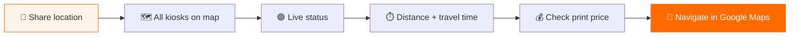
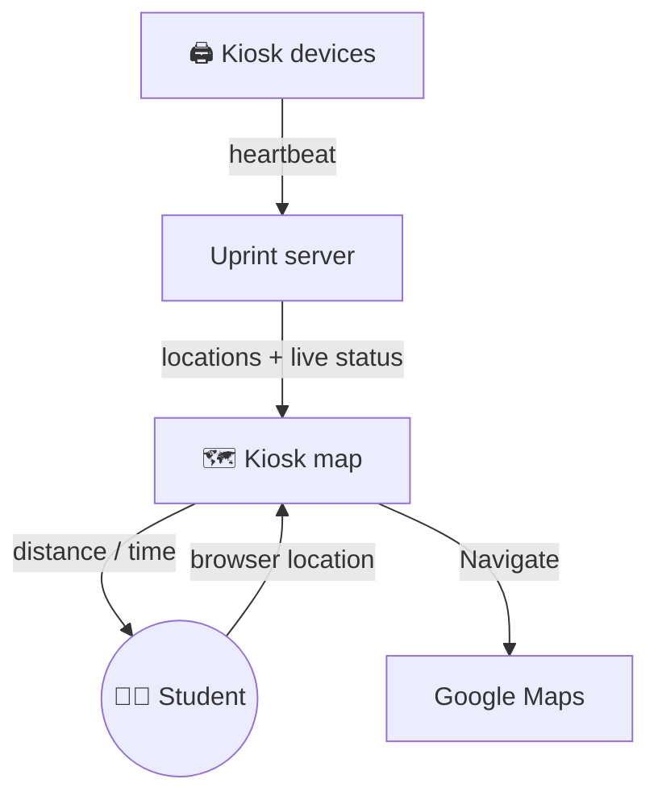

# 📍 Find Nearest Uprint Kiosk

### Your nearest printer, one tap away.

A live map of every **[Uprint](https://uprintbd.com)** self-service printing kiosk. It shows real-time status, distance and travel time from where you are, then sends you there.

---

## ⚡ The problem → the fix

> "Is there a working printer near me right now?" Before this, students had no way to know without walking there.

**Find Nearest Uprint Kiosk** answers that in one glance: which kiosks are **online**, how far they are, and how long it takes to get there **on foot or by rickshaw/CNG**.

---

## ✨ Features

| | Feature | What it does |
|:-:|---|---|
| 🗺️ | **Live map** | Every Uprint kiosk plotted alongside your current location |
| 🟢 | **Real-time status** | Each kiosk shown as `Online`, `Printer Disconnected` or `Offline` |
| ⏱️ | **Distance & travel time** | Live from your position, per kiosk |
| 🚶 | **Travel modes** | Switch between **Walk** and **Rickshaw / CNG**, built for how Chattogram actually moves |
| 💰 | **Print price** | See each kiosk's rates before you go |
| 🧭 | **Navigate** | One tap opens turn-by-turn directions in Google Maps |
| 🔓 | **Public view** | Anyone sees the map; logging in unlocks personal distance and time |
| 🛠️ | **Admin tools** | Admin and sales set each kiosk's location and preview the map as a user |

---

## 🟢 Status legend

| Status | Meaning |
|---|---|
| 🟢 **Online** | Kiosk and printer ready, go print |
| 🟠 **Printer Disconnected** | Kiosk is up, printer needs attention |
| ⚫ **Offline** | Kiosk not reachable right now |

---

## 🏗️ How it works

---

## 👨‍💻 My role

- Designed and built the feature end to end: map view, live status, distance and travel-time logic, and admin location tools
- Added local travel modes (Walk, Rickshaw / CNG) to fit how students in Chattogram get around
- Shipped to production at **[uprintbd.com](https://uprintbd.com/uprint/nearby-kiosks/)**

---

**Part of the Uprint platform:**
[📄 Uprint Lab Sheet Builder](https://github.com/MSSohan/Uprint-Lab-Sheet-Builder) ·
[📍 Find Nearest Uprint Kiosk](https://github.com/MSSohan/Find-Nearest-Uprint-Kiosk) ·
[🛠️ Uprint Kiosk Management](https://github.com/MSSohan/Uprint-Kiosk-Management)

The production source code is private. This repository is a showcase of the feature.

